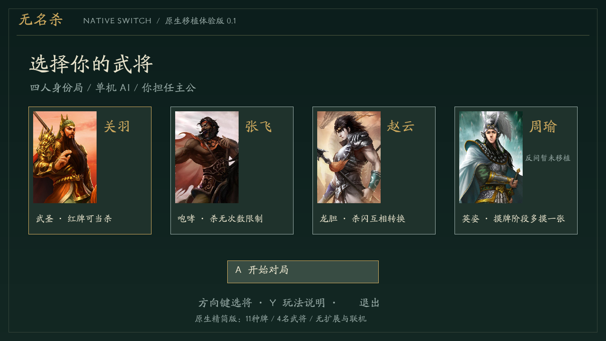
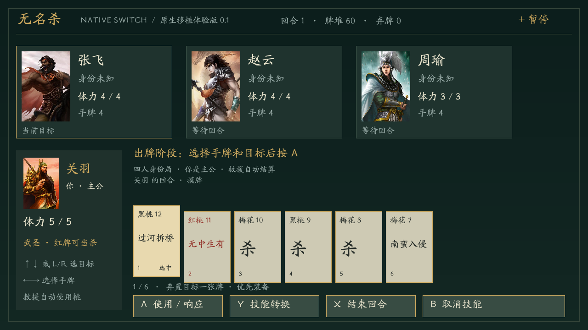

# 无名杀 Switch Native — 0.1.0 原生体验版

基于 [无名杀本体](https://github.com/libccy/noname) 的标准武将规则，以及 [无名杀懒人版](https://github.com/lieren2023/noname-for-dummies) 的标准牌数据、武将立绘和字体，制作的 Nintendo Switch Homebrew 原生精简移植。

**这是已编译的原生 NRO 首版，不是完整无名杀引擎移植。** 不执行上游 JavaScript，不支持原版扩展、完整武将库或联机；目前未经过 Switch 实机验证。已完成主机端规则测试及界面截图检查。

## 下载与安装

[下载 noname-switch.nro](dist/switch/noname-switch/noname-switch.nro) · [下载 SD 卡安装包](dist/noname-switch-v0.1.0-sd.zip)

1. 将安装包内的 `switch` 文件夹复制到 SD 卡根目录。最终路径为 `sd:/switch/noname-switch/noname-switch.nro`。
2. 在支持 Homebrew 的 Switch 中启动 hbmenu。建议从已安装游戏按住 R 进入完整应用模式。
3. 选择 **Noname Switch Native**，选将后按 A 开始。

NRO 内嵌字体和立绘，不需要网页服务、电脑伴随运行或外部素材目录。官方未修改系统不能直接启动 NRO。对局和设置暂不保存，退出即结束当前对局。

## 首版玩法

四人身份局：玩家固定担任主公，三个 AI 随机分配忠臣、反贼、内奸；每名武将仅出现一次。主公体力上限 +1。支持摸牌、出牌、弃牌、存活座次距离、响应、自动救援、阵亡奖励及身份胜负结算。

| 武将 | 首版技能 |
| --- | --- |
| 关羽 | 武圣：按 Y 将红色手牌当杀使用或打出 |
| 张飞 | 咆哮：使用杀无次数限制 |
| 赵云 | 龙胆：按 Y 将杀当闪、闪当杀使用或打出 |
| 周瑜 | 英姿：摸牌阶段额外摸一张；反间尚未移植 |

11 种牌，共 78 张，保留上游标准牌的花色、点数和张数：杀、闪、桃、无中生有、过河拆桥、顺手牵羊、决斗、南蛮入侵、万箭齐发、桃园结义、诸葛连弩。没有将其他牌替换为已支持牌；未实现牌直接从首版牌堆排除，因此平衡与完整标准牌堆不同。

### 明确的简化

- 濒死时自动用自身的桃自救；忠臣可自动使用桃救主公。其他救援选择尚未实现，主公不自动救其他角色。
- 顺手牵羊 / 过河拆桥优先获得 / 弃置连弩，目标没有装备时随机选择手牌。
- 没有无懈可击、判定区、其他装备、属性伤害、主公技、完整触发事件系统、音效、联网、扩展或存档。
- AI 是原生简易策略，未移植无名杀 JavaScript AI。选攻击目标时不读取对手隐藏身份或手牌内容。

## 操作

| 按键 | 功能 |
| --- | --- |
| 方向键左右 | 选将 / 选择手牌；超过 8 张时自动翻页 |
| 方向键上下或 L / R | 切换目标 |
| A | 开始 / 使用手牌 / 响应 / 弃置所选牌 |
| Y | 切换武圣、龙胆转换；选将界面查看说明 |
| X | 结束出牌；超出体力的手牌需要用 A 逐张弃置 |
| B | 放弃响应 / 关闭技能转换 |
| + | 暂停 |
| − | 在选将或暂停界面退出 |
| 触屏 | 点选武将、目标、手牌和底部按钮 |




## 编译

安装 devkitPro 的 `switch-dev` 和 Switch SDL2、SDL2_image、SDL2_ttf 及依赖。使用已有完整环境时：

```sh
export DEVKITPRO=/opt/devkitpro
export DEVKITA64=$DEVKITPRO/devkitA64
make -j2
```

输出 `noname-switch.nro`。资产已经放在 `romfs` 中，首次编译不必安装 Python 或下载完整上游仓库。构建工具版本和产物哈希见 [验证报告](docs/VALIDATION.md)。

Linux 桌面验证：安装 SDL2、SDL2_image、SDL2_ttf 开发包后，在仓库根目录运行：

```sh
make -f Makefile.host test
make -f Makefile.host
./noname-desktop
```

键盘方向键、A/B/X/Y、Enter、P/Esc、减号分别对应主机操作。无显示器可运行 `SDL_VIDEODRIVER=dummy ./noname-desktop --table --screenshot table.png`。

`python3 tools/import_data.py` 从随附的上游文件重新提取武将和牌堆，生成 `include/generated_data.hpp`。不会执行上游 JS。移植实现位于 `source/engine.cpp`，和 Switch / SDL 界面分离。

## 上游与许可

上游版本、文件来源及 SHA-256 见 [UPSTREAM.md](UPSTREAM.md) 与 `upstream/provenance.json`。本项目代码及派生数据以 GPL-3.0-or-later 提供，随附完整源码和 [GPL 文本](LICENSE)。上游立绘和字体保留其原有权利，本项目没有为这些素材授予新的版权许可，也不声称 GPL 代码许可覆盖所有美术素材。懒人版作者要求非商业学习交流使用，本首版用于该目的。项目不是官方三国杀或任天堂产品。

## 下一步移植

实机验证启动、Joy-Con、触屏和休眠恢复 → 补充救援选择与反间 → 无懈 / 判定 / 装备系统 → 更多武将与技能事件 → 存档与联机。完整本体/懒人版移植仍需持续开发。
